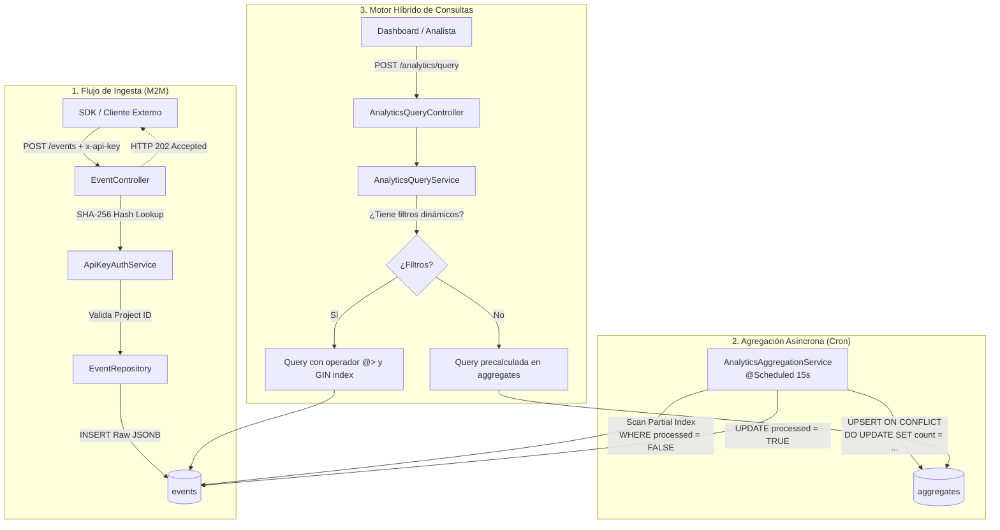

# Trazvent

[](https://github.com/)
[](https://openjdk.org/)
[](https://spring.io/projects/spring-boot)
[](https://www.postgresql.org/)
[](https://jwt.io/)
[](https://testcontainers.com/)

> **Motor multitenant de ingesta de eventos de alta concurrencia y analítica en tiempo real diseñado con Java 25, Spring Boot 4 y PostgreSQL.**

---

## Descripción del Proyecto

**Trazvent** es una plataforma SaaS de analítica de producto y telemetría de eventos (inspirada conceptualmente en soluciones como PostHog, Segment y Mixpanel). Permite a aplicaciones cliente registrar eventos de comportamiento de usuarios de forma asíncrona y flexible, transformando flujos de datos no estructurados en métricas cuantitativas consultables al instante.

### El Problema

Los sistemas analíticos modernos se enfrentan al clásico dilema entre:

1. **Flexibilidad en la ingesta**: Los clientes envían payloads heterogéneos con metadatos arbitrarios en formato JSON.
2. **Rendimiento en consulta**: Escanear millones de filas crudas en tiempo real para graficar dashboards degrada las bases de datos relacionales tradicionales.
3. **Seguridad multi-inquilino (Multi-Tenancy)**: Aislar de forma estricta los datos entre proyectos clientes sin incurrir en costes desmedidos de infraestructura.

### La Solución de Trazvent

Trazvent implementa un **motor híbrido de ingesta y consulta**:

- Recepción de eventos desacoplada y rápida (`HTTP 202 Accepted`).
- Almacenamiento semiestructurado con tipos nativos `JSONB` e indexación `GIN` en PostgreSQL.
- Pipeline programado de preagregación periódica (Rollup Batch) mediante sentencias atómicas `UPSERT` (`INSERT ... ON CONFLICT`).
- Enrutamiento inteligente de consultas (_Smart Query Routing_): consultas generales leen tablas precalculadas en tiempo constante ($O(1)$ por intervalo diario), mientras que consultas filtradas por propiedades dinámicas aprovechan los índices invertidos `GIN` sobre la tabla de eventos crudos.

---

## Estado del Proyecto (Work in Progress)

> [!NOTE]  
> **Proyecto Activo en Desarrollo:** Trazvent cuenta con el núcleo funcional completado: pipeline de ingesta, mecanismo de autenticación dual (API Key + JWT), motor de agregación programada mediante Spring Scheduler y enrutador dinámico de consultas analíticas.

---

## Tech Stack

### Backend & Core

- **Java 25**: Utilizando características modernas del lenguaje (records, pattern matching, virtual thread readiness).
- **Spring Boot 4.0.5**:
    - `spring-boot-starter-webmvc` para la exposición de endpoints RESTful.
    - `spring-boot-starter-data-jpa` para persistencia relacional con Hibernate.
    - `spring-boot-starter-validation` para validación estricta de payloads con Jakarta Bean Validation.
    - `JdbcTemplate` para optimizaciones de bajo nivel en batching y consultas analíticas de alto rendimiento.
- **Lombok**: Reducción de boilerplate en entidades y servicios.

### Base de Datos & Persistencia

- **PostgreSQL 16**:
    - Almacenamiento JSONB de metadatos (`properties`, `traits`).
    - Índices GIN (`idx_events_properties`) para filtros sobre atributos JSON.
    - Índices parciales (`WHERE processed IS FALSE`) para optimizar el scheduler de agregación.
    - Índices compuestos B-Tree (`(project_id, timestamp)`).
- **Flyway Migration**: Versionado y control evolutivo de esquemas DDL (`V1`, `V2`, `V3`).

### Seguridad & Autenticación

- **Spring Security**: Configuración _stateless_ desacoplada.
- **API Key Hashing**: Validación criptográfica M2M mediante `SHA-256` para aislamiento estricto multi-tenant.
- **JSON Web Tokens (JJWT 0.12.5)**: Tokens de sesión firmados con HMAC-SHA para autenticación en paneles de administración.
- **BCrypt**: Hashing unidireccional de contraseñas de usuarios.

### Infraestructura, Testing & Herramientas

- **Docker & Docker Compose**: Orquestación local del contenedor de base de datos (`postgres:16-alpine`).
- **Testcontainers**: Integración continua con entornos de pruebas reales de PostgreSQL aislados por test.
- **Mise & Gradle**: Gestión reproducible de entornos y dependencias.

---

## Arquitectura y Características Principales



---

### 1. Ingesta de Eventos Crudos (Raw Event Ingestion)

El endpoint de ingesta (`POST /events`) está diseñado siguiendo patrones de sistemas de alta disponibilidad:

- **Respuesta Asíncrona (`HTTP 202 Accepted`)**: El sistema confirma la recepción inmediata con un `eventId` único generado como UUID v4, desacoplando la ingesta de cargas pesadas de procesamiento.
- **Validación Declarativa**: El DTO `EventRequest` garantiza la consistencia de los tipos de datos primordiales (`event`, `timestamp`, `properties`) mediante anotaciones Jakarta Validation (`@NotBlank`, `@NotNull`).
- **Mapeo JSONB con Hibernate 6+**: Los atributos adicionales se almacenan en un mapa heterogéneo (`Map<String, Object>`) vinculado directamente a la columna nativa `jsonb` de PostgreSQL con `@JdbcTypeCode(SqlTypes.JSON)`.

---

### 2. Pipeline de Agregación Batch de Eventos

Para balancear el rendimiento de consultas a gran escala sin penalizar la velocidad de escritura de eventos entrantes, Trazvent implementa un proceso de consolidación periódico en `AnalyticsAggregationService`:

- **Ejecución Periódica**: Implementado con `@Scheduled(fixedRate = 15000)` dentro de una transacción atómica `@Transactional`.
- **Bypass de ORM con `JdbcTemplate`**: Se evita deliberadamente el overhead de hidratación de entidades de Hibernate para ejecutar directamente sentencias SQL nativas de alto rendimiento.
- **UPSERT Atómico con `ON CONFLICT`**:
    ```sql
    INSERT INTO aggregates (project_id, event_name, date, count)
    SELECT project_id, event_name, CAST(timestamp AS DATE), COUNT(*)
    FROM events
    WHERE processed = FALSE
    GROUP BY project_id, event_name, CAST(timestamp AS DATE)
    ON CONFLICT (project_id, event_name, date)
    DO UPDATE SET count = aggregates.count + EXCLUDED.count;
    ```
- **Optimización de Índices Parciales**: Para evitar lecturas secuenciales sobre la tabla `events`, la migración `V2` incorpora un índice condicional:
    ```sql
    CREATE INDEX idx_events_unprocessed ON events (id) WHERE processed IS FALSE;
    ```
    Esto reduce drásticamente el espacio de búsqueda del planificador de PostgreSQL, limitando el escaneo exclusivamente a los nuevos registros pendientes de procesar.
- **Transición de Estado**: Tras el volcado a la tabla `aggregates`, se actualiza masivamente la bandera `processed = TRUE`.

---

### 3. Motor de Consulta Analítica Híbrido (Smart Query Routing)

El servicio `AnalyticsQueryService` implementa una estrategia de enrutamiento dual según la granularidad solicitada en `QueryRequest`:

```
                           ┌───────────────────────────────┐
                           │    POST /analytics/query      │
                           └───────────────┬───────────────┘
                                           │
                                ┌──────────┴──────────┐
                                ▼                     ▼
                       [Sin Filtros JSON]     [Con Filtros JSON]
                                │                     │
                                ▼                     ▼
                      Tabla `aggregates`        Tabla `events`
                    (Lectura Precalculada)    (JSONB @> + GIN Index)
                                │                     │
                                └──────────┬──────────┘
                                           ▼
                                 List<DataPoint>
```

1. **Camino Rápido (Preagregado)**:
    - Si la consulta no requiere filtros por propiedades dinámicas (`request.filters().isEmpty()`), se consultan los registros consolidados de `aggregates`.
    - Rendimiento sub-milisegundo al agrupar únicamente fechas y no registros individuales.
2. **Camino Dinámico (Raw Event Filtering)**:
    - Cuando se especifican filtros en el payload, la consulta se desvía a la tabla de eventos crudos.
    - Utiliza el operador de contención JSONB `@>` de PostgreSQL:
        ```sql
        SELECT CAST(timestamp AS DATE) as date, COUNT(*) as total
        FROM events
        WHERE project_id = ?
          AND event_name = ?
          AND CAST(timestamp AS DATE) >= ?
          AND CAST(timestamp AS DATE) <= ?
          AND properties @> ?::jsonb
        GROUP BY CAST(timestamp AS DATE)
        ORDER BY date ASC;
        ```
    - Esta sentencia es acelerada por el índice **GIN (Generalized Inverted Index)** creado en `V1`:
        ```sql
        CREATE INDEX idx_events_properties ON events USING GIN (properties);
        ```
    - La serialización del filtro se realiza de forma segura mediante Jackson y enlaces parametrizados para mitigar cualquier riesgo de inyección SQL.

---

### 4. Seguridad y Control de Autenticación Dual

Trazvent desacopla el modelo de seguridad en dos capas bien diferenciadas:

#### A. Autenticación M2M (Ingesta de Eventos y Queries con API Keys)

- Los clientes envían su clave en la cabecera HTTP `x-api-key`.
- **Cero claves en texto plano**: Las claves nunca se guardan en claro. Al recibir una petición, `ApiKeyAuthService` computa el hash `SHA-256`:
    ```java
    MessageDigest digest = MessageDigest.getInstance("SHA-256");
    byte[] hash = digest.digest(apiKey.getBytes(StandardCharsets.UTF_8));
    String hashedKey = HexFormat.of().formatHex(hash);
    ```
- Se busca el registro correspondiente en la tabla `projects` mediante el hash. Si es válida, se extrae el `UUID projectId` del inquilino; de lo contrario, se arroja una excepción personalizada.

#### B. Autenticación de Usuarios de Dashboard (JWT + RBAC)

- Arquitectura estándar basada en `SecurityFilterChain` _stateless_.
- Contraseñas almacenadas de forma segura utilizando `BCryptPasswordEncoder`.
- Los endpoints `/auth/login` emiten un token JWT firmado con claims enriquecidos (`projectId`, `role`).
- `JwtAuthenticationFilter` intercepta las cabeceras `Authorization: Bearer <token>`, valida la firma criptográfica y la expiración, y establece el contexto en `SecurityContextHolder`.
- Control de roles granular mediante la enumeración `Role` (`ADMIN`, `VIEWER`).

#### C. Manejo Global de Excepciones (RFC 7807 Problem Details)

Todas las anomalías de autenticación y validación son capturadas por `GlobalExceptionHandler` y formateadas bajo la especificación estándar **RFC 7807 (`ProblemDetail`)**:

```json
{
    "type": "about:blank",
    "title": "Authentication Error",
    "status": 401,
    "detail": "API Key not provided in the headers.",
    "code": "MISSING_KEY"
}
```

---

## Catálogo de Endpoints

### Ingesta de Eventos

| Método | Endpoint  | Cabeceras Requeridas       | Descripción                                            |
| :----- | :-------- | :------------------------- | :----------------------------------------------------- |
| `POST` | `/events` | `x-api-key: <RAW_API_KEY>` | Ingesta asíncrona de un nuevo evento crudo (HTTP 202). |

### Analítica y Consultas

| Método | Endpoint           | Cabeceras Requeridas       | Descripción                                                |
| :----- | :----------------- | :------------------------- | :--------------------------------------------------------- |
| `POST` | `/analytics/query` | `x-api-key: <RAW_API_KEY>` | Consulta agregada por rango de fechas y filtros dinámicos. |

### Autenticación y Usuarios

| Método | Endpoint      | Cabeceras Requeridas          | Descripción                                        |
| :----- | :------------ | :---------------------------- | :------------------------------------------------- |
| `POST` | `/auth/login` | _Ninguna_                     | Autenticación con email/password y retorno de JWT. |
| `GET`  | `/auth/me`    | `Authorization: Bearer <JWT>` | Perfil y roles del usuario autenticado.            |

---

## Cómo Ejecutar en Local (Getting Started)

### Prerrequisitos

- **Java 25** (o mediante [mise](https://mise.jdx.dev/): `mise install`).
- **Docker & Docker Compose** (para ejecutar la base de datos PostgreSQL).
- **Git**.

---

### Paso 1: Clonar el Repositorio

```bash
git clone https://github.com/tu-usuario/Trazvent.git
cd Trazvent
```

---

### Paso 2: Configurar las Variables de Entorno

Copia el archivo de plantilla `.env.example` y define tus credenciales locales:

```bash
cp .env.example .env
```

Edita `.env` con tus configuraciones deseadas (por ejemplo):

```env
DB_NAME=trazvent_db
DB_USER=trazvent_user
DB_PASSWORD=trazvent_password
ENVIRONMENT=dev
JWT_SECRET=404E635266556A586E3272357538782F413F4428472B4B6250645367566B5970
```

> [!TIP]
> `JWT_SECRET` debe ser una clave en base64 de al menos 256 bits para garantizar la seguridad del algoritmo HMAC-SHA256.

---

### Paso 3: Levantar PostgreSQL con Docker Compose

Inicia el contenedor de base de datos en segundo plano:

```bash
docker compose up -d
```

Verifica que el servicio esté saludable:

```bash
docker compose ps
```

---

### Paso 4: Compilar y Ejecutar la Aplicación

El proyecto utiliza el Gradle Wrapper. El plugin de Spring Boot cargará automáticamente el archivo `.env` configurado:

```bash
./gradlew bootRun
```

Flyway aplicará automáticamente las migraciones en la base de datos (`V1__init_schema.sql`, `V2__add_processed_flag_to_events.sql`, `V3__add_role_to_users.sql`).

La aplicación estará lista en: `http://localhost:8080`.

---

### Paso 5: Ejecutar los Tests

El proyecto integra **Testcontainers**, por lo que los tests de integración levantarán automáticamente una instancia efímera de PostgreSQL en Docker:

```bash
./gradlew test
```

---

## Pruebas Rápidas con cURL

### 1. Ingestar un Evento Crudo

```bash
curl -X POST http://localhost:8080/events \
  -H "Content-Type: application/json" \
  -H "x-api-key: TU_API_KEY_AQUI" \
  -d '{
    "event": "button_clicked",
    "timestamp": "2026-10-12T03:00:00Z",
    "userId": "usr_9981",
    "anonymousId": "anon_124",
    "properties": {
      "button_id": "checkout_cta",
      "plan": "enterprise",
      "browser": "Chrome"
    }
  }'
```

_Respuesta esperada (`202 Accepted`):_

```json
{
    "eventId": "e9c1d2e8-4b77-4b7c-86fa-0f56f1a8c90b",
    "message": "Event recorded."
}
```

### 2. Consultar Métricas Agregadas

_(Pasados 15 segundos, el cron habrá consolidado los datos en la tabla `aggregates`)_

```bash
curl -X POST http://localhost:8080/analytics/query \
  -H "Content-Type: application/json" \
  -H "x-api-key: TU_API_KEY_AQUI" \
  -d '{
    "eventName": "button_clicked",
    "startDate": "2026-10-01",
    "endDate": "2026-10-15"
  }'
```

_Respuesta esperada (`200 OK`):_

```json
[
    {
        "date": "2026-10-12",
        "value": 1
    }
]
```

### 3. Consultar Métricas con Filtros Dinámicos (JSONB)

```bash
curl -X POST http://localhost:8080/analytics/query \
  -H "Content-Type: application/json" \
  -H "x-api-key: TU_API_KEY_AQUI" \
  -d '{
    "eventName": "button_clicked",
    "startDate": "2026-10-01",
    "endDate": "2026-10-15",
    "filters": {
      "plan": "enterprise"
    }
  }'
```

---

## Autor

Desarrollado por **Joaquín Palacio**
